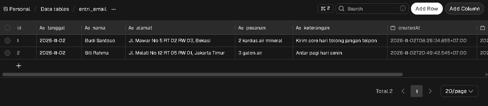
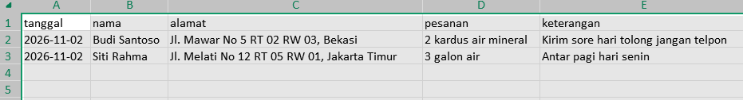
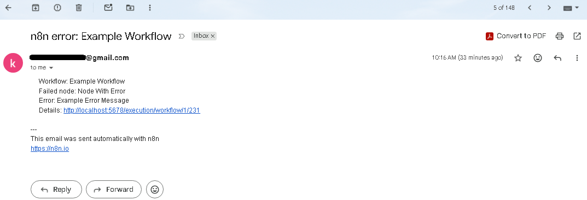

# Email-to-Excel Data Entry Automation (n8n)

A personal project that replaces manual re-typing of order emails into Excel. Order details arrive by email as free text, an n8n workflow parses them into a database table, and a scheduled workflow writes a clean daily Excel report. A third workflow sends an alert email when anything fails.

> Personal portfolio project. All data in this repository is dummy data.

## The problem

Order information (name, address, order, notes) arrives by email in a simple text format. Someone has to copy it into an Excel file every day. This is slow and error-prone, especially when an address or note spans several lines and gets cut off.

## What it does

| Workflow | Purpose |
|---|---|
| **A. Email to Data Table** | Reads new emails from a Gmail label, parses the fields (including multi-line values), cleans the text, and saves one row per email to a data table. |
| **B. Daily Excel Report** | Runs on a schedule, takes today's rows from the table, and writes `entri_YYYY-MM-DD.xlsx` to a local folder. |
| **C. Error Alert** | Runs when workflow A or B fails and emails the workflow name, the failed node, the error message, and a link to the execution. |

## Architecture

```
Gmail label "EntriData"
        |
        v
[A] Email Trigger (IMAP) -> Code (parse + normalize) -> Data table: entri_email
                                                              |
[B] Schedule Trigger -> Get row(s) (today) -> Edit Fields -> Convert to File (XLSX) -> Write File
                                                              |
                                              C:\EntriData\entri_YYYY-MM-DD.xlsx

[C] Error Trigger -> Send Email   (set as the error workflow of A and B)
```

## Email format

```
Nama: budi santoso
Alamat: jl. mawar no 5
rt 02 rw 03, bekasi
Pesanan: 2 kardus air mineral
Keterangan: kirim sore hari
tolong jangan telpon
```

Result in the table and in Excel:

| tanggal | nama | alamat | pesanan | keterangan |
|---|---|---|---|---|
| 2026-11-02 | Budi Santoso | Jl. Mawar No 5 RT 02 RW 03, Bekasi | 2 kardus air mineral | Kirim sore hari tolong jangan telpon |

Parsing rules:
- The four labels (`Nama`, `Alamat`, `Pesanan`, `Keterangan`) are case-insensitive.
- Lines without a label are appended to the previous field, so multi-line values are kept.
- Emails without a `Nama` field are skipped (for example newsletters or job alerts).
- Names and addresses are converted to title case, `RT` and `RW` stay in capitals, and the date uses the Asia/Jakarta timezone.

## Setup

Requirements: Docker Desktop, a Gmail account with 2-Step Verification, and a Google app password.

1. Start n8n (PowerShell), with a local folder mounted for the Excel files:

   ```
   docker volume create n8n_data
   docker run -d --name n8n --restart unless-stopped -p 5678:5678 -e GENERIC_TIMEZONE=Asia/Jakarta -e TZ=Asia/Jakarta -e N8N_RESTRICT_FILE_ACCESS_TO=/files -v n8n_data:/home/node/.n8n -v C:\EntriData:/files docker.n8n.io/n8nio/n8n
   ```

2. Open `http://localhost:5678` and create the owner account.
3. Create a data table named `entri_email` with five string columns: `tanggal`, `nama`, `alamat`, `pesanan`, `keterangan`.
4. In Gmail, create a label `EntriData` and a filter that applies it to the incoming order emails.
5. Create the credentials in n8n: IMAP (`imap.gmail.com`, port 993, SSL on) and SMTP (`smtp.gmail.com`, port 465, SSL on), both using a Google app password.
6. Import the workflow files from the `workflows/` folder, select the credentials, and set `Error Alert - Entri Data` as the error workflow of the other two.
7. Publish the three workflows.

Credentials are not included in this repository and must be created in your own n8n instance.

## Design decisions

- **A data table between the email and the Excel file.** Appending rows to an existing `.xlsx` is fragile (read, merge, rewrite, and handle the first email of the day). Storing rows in a table and generating the Excel file once a day is simpler and more reliable, and the table also acts as the single source of truth.
- **A dedicated Gmail label.** Reading the whole inbox would mark unrelated emails as read.
- **Restricted file access.** n8n can only write to the mounted `/files` folder.
- **A separate error workflow.** One alert workflow is reused by both main workflows, so failures are not silent.

## Testing

- Parsing was tested with multi-line addresses and notes, and with an email that is not in the expected format (it is skipped).
- The error alert was tested with a deliberately failing scheduled workflow, and the alert email arrived with the right workflow name and error message.

## Limitations

- It runs only while the computer and Docker Desktop are on. A run scheduled while the computer is off is skipped.
- The parser expects the four labels; completely free-form text is not supported.
- The execution link in the alert email points to `localhost`, so it opens only on the same computer.
- There is no duplicate detection.
- Credentials and the Gmail label and filter are set up manually.

## Possible improvements

- Duplicate detection (for example by name, address, and date).
- Extracting fields from free-form emails with an AI node, with validation.
- Moving the table to PostgreSQL and adding a dashboard.
- Running on an always-on server instead of a personal computer.

## Screenshots

   ### Workflow A: Email to Data Table
   

   ### Workflow B: Daily Excel Report
   

   ### Data table
   

   ### Excel output
   

   ### Alert email
   
